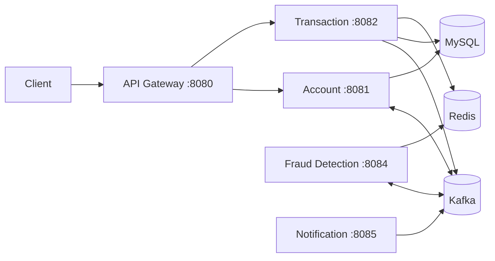

# Banking System

A Java Spring Boot microservices project for managing bank accounts, transferring funds, checking transactions for fraud and verifying suspicious transfers with an OTP.

## Technologies

- Java and Spring Boot
- Spring Cloud Gateway and OpenFeign
- Spring Data JPA and MySQL
- Apache Kafka and Redis
- Docker Compose and Springdoc OpenAPI

## Architecture



| Service | Port | Role |
| --- | ---: | --- |
| API Gateway | 8080 | Routes and rate-limits API requests; hosts the combined Swagger UI |
| Account Service | 8081 | Creates accounts and manages account balances and status |
| Transaction Service | 8082 | Transfers, transaction history, OTP verification |
| Fraud Detection Service | 8084 | Checks transfers consumed from Kafka |
| Notification Service | 8085 | Logs notification messages consumed from Kafka |

The account and transaction services use separate MySQL databases. Kafka carries events between services; Redis stores OTPs and fraud-check counters.

## How the flows work

For each transfer, the sender is debited and the transaction is checked for suspicious activity, including transfer frequency, amount history, and available balance. A transfer that passes is completed and the receiver is credited. A flagged transfer is held for a six-digit OTP, stored for five minutes; a correct code completes the transfer, while an incorrect code triggers account blocking and a refund attempt. An expired code also triggers a refund attempt. Notification Service records messages for verification, completed transfers, account blocking, and refunds.

## Run the project

**Requirements:** JDK 17 or newer and Docker Compose.

1. Start MySQL, Kafka, Zookeeper, and Redis from the project root:

   ```powershell
   docker compose up -d
   ```

2. Start each service from IntelliJ using its `*Application` class, or open a terminal for each module and run:

   ```powershell
   .\mvnw.cmd spring-boot:run
   ```

3. Open the combined Swagger UI at **http://localhost:8080/swagger-ui.html** to explore the Account and Transaction APIs.

## Main API routes

| Method | Path | Purpose |
| --- | --- | --- |
| `POST` | `/api/v1/accounts` | Create an account |
| `GET` | `/api/v1/accounts/{accountNumber}` | Get account details |
| `GET` | `/api/v1/accounts/{accountNumber}/balance` | Get balance |
| `POST` | `/api/v1/transactions/transfer` | Start a transfer |
| `GET` | `/api/v1/transactions/{transactionId}` | Get transaction status/details |
| `GET` | `/api/v1/transactions/account/{accountNumber}` | Get sent transaction history |
| `POST` | `/api/v1/transactions/{transactionId}/verify?otp={code}` | Verify a pending OTP |
